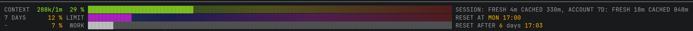
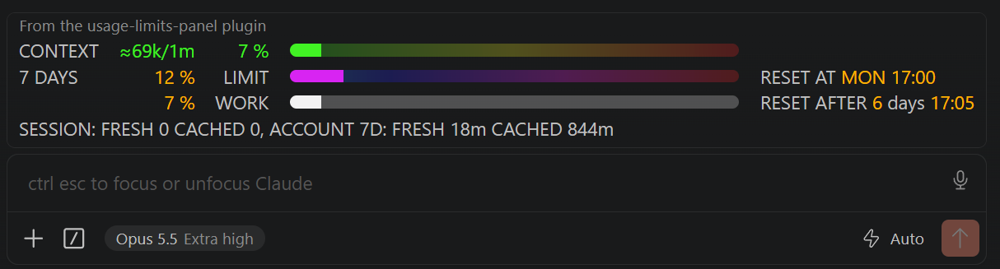
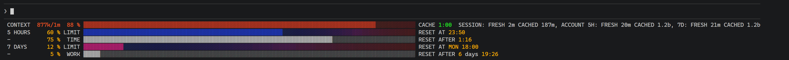

# A ready-made `.claude/` folder for your projects

Everything [Claude Code](https://claude.com/claude-code) picks up from a repository, in one folder
you copy into a project:

- a **status line** that shows how much of your Claude subscription you have used — in the terminal,
  and as a panel above the prompt in **VS Code** — and gives the model the same numbers;
- a **session log** that records what actually happened in each session;
- a **sound** when Claude finishes or needs you;
- **nine rules** that shape how the model works — when to stop and ask, what "finished" means, how to
  report back;
- a **reviewer** that checks every change without knowing what its author meant it to do;
- a **guide to writing prompts**, which Claude opens only when a task needs it.

There is nothing to install — no Node, no Python, no Go. The hooks are small ready-built programs for
macOS, Linux and Windows, and everything else is plain text.

In a terminal, the status line under the prompt:



In VS Code, which shows no status line, the same picture above the box you type in:



## Your usage limits, always in view

A Claude subscription has several limits running at once: a **5-hour window** on most plans, a
**weekly window**, and for some models a **weekly allowance of their own**. A verified Ultra account
has no 5-hour window at all; the hook then simply shows no row for it. The status line and the VS Code
panel show the two windows; a model's own allowance goes only into the numbers the model is given. Every Claude session
you have open draws from the same limits. Claude Code shows them when you type `/usage`, but the model — the one deciding
how much work to take on — never sees them. So you either stop early to be safe, or run into the wall
in the middle of something.

This hook keeps the numbers in front of both of you.

### Reading the bars

The terminal and VS Code show the same bars, figures and colours; what differs in VS Code is
[below](#in-vs-code). Each limit is a pair of bars:

- **LIMIT** — how much of it you have spent;
- **TIME** — how much of the window has passed. The weekly limits say **WORK** instead, because they
  count working hours (more on that below).

In a terminal every bar has one cell for each percent, so it reads straight as the number beside it;
only a terminal too narrow for a hundred cells gets shorter bars.

**When the top bar is ahead of the bottom one, you are spending faster than time is passing**, and the
limit will run out before it resets. The colour tells you the same at a glance: the LIMIT bar is
blue while spending keeps pace with time, and its filled part turns through violet to red as
spending gets ahead, fully red once it is 10 points ahead, while its empty part shows that whole
scale, blue to red; the TIME and WORK bars are white. **RESET AT** is
when the limit resets, and **RESET AFTER** is how long that is from now.

**The weekly bars count working hours, not calendar hours.** Nobody spends budget at four in the
morning, and weekends use little of it — so a calendar bar ran ahead of the spend every Monday and
fell behind it every Friday. You set which hours you work, and how much each day counts, in the
settings file.

The top line is about this session:

- **CONTEXT** — how full the conversation is. This is not a subscription limit; it is why a long
  session eventually gets compacted. It turns from green to red as it fills, and its empty part
  shows the colours still ahead of it.
- **CACHE** — how long the prompt cache stays warm. Once it runs out, the next message costs more,
  because the whole conversation has to be cached again.
- **SESSION** and **ACCOUNT** — the tokens this session has used, and those of every session on this
  computer in the 5-hour window (where there is one) and the weekly one. **FRESH** is new work.
  **CACHED** is the conversation being read back from the cache on every message; it costs a tenth as
  much, which is why the number gets so large. On a terminal too narrow for them beside the bar, they
  move to a line of their own under the limits.

Late in a long session the CONTEXT bar turns red. The limits keep their own colours, because those
follow your pace rather than how full they are. Here on a plan with a 5-hour window as well as the
weekly one:



### In VS Code

Claude Code's panel in VS Code shows no status line, so a small plugin that comes with this folder
draws the same picture just above the box you type in. It takes everything from the hook — the
figures, the words and the colours — so it always says what the status line would. Three things look
different:

- the bars are drawn as solid bars, each as wide as the panel allows, rather than as rows of
  characters;
- the token counts stand on a line of their own, last;
- before the first reply of a new chat, when nothing has measured the context yet, CONTEXT shows
  Claude Code's own estimate, marked with **≈**.

You turn it on once per computer, not per project, by naming its folder — wherever this repository
is on your machine — in your own `~/.claude/settings.json`:

```json
{
  "env": {
    "CLAUDE_CODE_PLUGIN_DIRS": "D:\\src\\claude-code-hooks\\scripts\\usage-limits-panel"
  }
}
```

From then on it shows in every new VS Code chat, in every project that has the hook, and nowhere
else: a terminal has the status line itself. It needs version 2.1.309 or later of the VS Code
extension. A project whose hook is older than the plugin gets a line saying so in place of the bars;
copying in the current hook fixes it.
[REFERENCE.md](REFERENCE.md#in-vs-code-the-panel) says why it is set up this way and how it differs
from the status line.

### What the model sees

Before each of your messages, the model gets the same numbers as a short block of data — just the
figures, no bars:

```xml
<usage_limits scope="account-global: every session on this subscription" format="tokens in k/m/b; clock times local; waits h:mm">
<context used="867k of 1m (87%)"/>
<limit name="5-hour" used="58%" gone="70% of the window" resets="23:50, in 1:31"/>
<limit name="7-day" used="16%" gone="5% of the working week" resets="MON 18:00, in 6 days 19:41"/>
<limit name="Fable weekly bucket" used="0%" gone="5% of the working week" resets="MON 18:00, in 6 days 19:41"/>
<tokens session="fresh 2m, cached 164m" account_5h="fresh 19m, cached 1.1b" account_7d="fresh 20m, cached 1.1b"/>
<burn window="5-hour" rate="0.16%/min, sampled" forecast="lasts to the reset at 23:50" pace="0.8"/>
<zone level="YELLOW" limiter="session">be lean: avoid re-reads and work nobody asked for.</zone>
</usage_limits>
```

Numbers alone change nothing. The **session-budget** rule is what makes the model act on them: match
the effort to the task rather than to what is left, and stop short of a limit instead of running into
it. The last line — the **zone**, from GREEN to RED — says how tight things are.

### Extra agents follow the task, not the limits

Nothing stops the model from launching an extra agent because a limit is near. Whether it launches one
is decided by how complex the task is; the zone only narrows how much work it takes on.

## A log of every session

Ask a model what it did and you get a story it wrote about itself. This hook keeps the record
instead, straight from what Claude Code reports: your messages, the answers you picked when it asked
you something, which model worked and for how long, which files changed and on which lines, and the
final answer. There is one file per session in `management/logs/`, sorted by person and by day.

## A sound when it needs you

A short sound when Claude finishes, fails, or is waiting for you, so you can look away while it works.
To change it, replace `.claude/sounds/notify.wav` with any WAV file.

## The rules

Nine documents in `.claude/rules/` that Claude Code reads at the start of every session. They change
how the model works, not what it can see:

| Rule                         | In one line                                                                                 |
| ---------------------------- | ------------------------------------------------------------------------------------------- |
| **session-budget**           | Spend in proportion to the task; a limit is a wall to stop short of, not a budget to fill   |
| **before-starting-work**     | Bring the branch up to date and read what came in before doing anything else                |
| **working-autonomously**     | Carry a task to the end instead of handing it back half done                                |
| **architectural-forks**      | Decisions that are expensive to undo go to you first, with the options and a recommendation |
| **code-quality**             | Fix the cause, not the symptom — and when a model misbehaves, fix what it was given         |
| **finishing-work**           | Check, run and review every change before the turn ends; never commit unless asked          |
| **merge-conflicts**          | Resolve conflicts by hand, understanding both sides; never force anything                   |
| **response-style**           | Answer in your language, in plain words, with a short report after every piece of work      |
| **web-search-when-in-doubt** | When something behaves unexpectedly, check the current documentation before the next fix    |

The rules refer to each other by name, so **take them as a set**. Read them before installing: they
apply from the next session on, and every session carries them in its context.

## The reviewer

`change-reviewer` checks a change **without being told what its author intended** — it gets only the
change and the requirement. An author reads code as what they meant; a reviewer who sees only the code
sees what it actually does. It is told to try to break the change, it runs the code, and it cannot
edit anything. The finishing-work rule runs it once at the end of every change.

## The prompt-writing guide

`dev-ai-prompt-generation` is a guide to writing prompts, skills, rules and `CLAUDE.md` files: a short
overview plus 30 topic files. Unlike a rule, it costs nothing until it is used — Claude opens it only
when a task calls for it.

## Installing

The easiest way: open Claude Code in your project and ask it to install this repository, pointing it
at [AGENTS.md](AGENTS.md). That file takes it through every step, including the two that are easy to
miss on Windows, and a check that the install worked.

By hand, copy the folders across:

```sh
mkdir -p <project>/.claude <project>/scripts
cp -r .claude/hooks .claude/sounds .claude/usage-limits-config.json <project>/.claude/
cp -r scripts/usage-limits-* scripts/work-audit-* scripts/play-sound-* <project>/scripts/
cp -r .claude/rules .claude/agents .claude/skills <project>/.claude/   # the rules, the reviewer, the guide
```

Then merge `.claude/settings.json` into the project's own, or copy it if the project has none. Copy
`.gitattributes` too, and if you commit from Windows, mark the hooks executable — the command is in
[REFERENCE.md](REFERENCE.md#installing-this-in-another-project). Without these, the hooks quietly do
nothing for anyone working on a Mac or Linux.

**Using VS Code?** Copying the files is not enough for the panel: it is turned on once per computer,
as [In VS Code](#in-vs-code) shows, and then draws the bars in every project that has the hook.

## Settings you might want to change

They live in `.claude/usage-limits-config.json`:

| Setting               | What it changes                                                                  |
| --------------------- | -------------------------------------------------------------------------------- |
| `working_week`        | Which hours you work each day, and how much each day counts                      |
| `time_zone`           | The time zone your working day is in                                             |
| `zones`               | The percentages at which the zones turn YELLOW, ORANGE and RED                   |
| `limit_ahead_red_pct` | How far spending may run ahead of time before a bar is fully red (10 by default) |
| `fetch_ttl_sec`       | How often your usage is fetched, in seconds (every minute by default)            |

If the hook cannot use a value, it says so on a `CONFIG` line under the bars and carries on with the
rest of the file.

## What the hooks never do

- **Break a session.** If anything goes wrong — no network, a broken setting, a missing file — they
  step aside quietly.
- **Send your data anywhere.** The only request they make is asking Anthropic for your own usage,
  with the login Claude Code already has. No API key is needed.
- **Keep much.** Three small files in your Claude folder — the usage figures, a note that the brake
  has asked, and token counts, never what your sessions said — plus the session log in the project.

## Requirements

Claude Code, signed in, and for the panel in VS Code, version 2.1.309 or later of the extension. The
hooks run on macOS (Apple Silicon), Linux (x86-64) and Windows (x86-64).
For anything else, such as an Intel Mac or an ARM Linux machine, you can build them yourself —
[REFERENCE.md](REFERENCE.md#requirements) shows how.

## More detail

[REFERENCE.md](REFERENCE.md) describes everything in full: every part of the status line and of the
model's block, how working time is counted, every setting and what the hook checks in it, what the
session log records, which hook runs on which Claude Code event, and how to build from source.
[AGENTS.md](AGENTS.md) is the install procedure.

## License

MIT — see [LICENSE](LICENSE). Use it, change it and ship it in your own projects; keep the copyright
notice with the copy.
